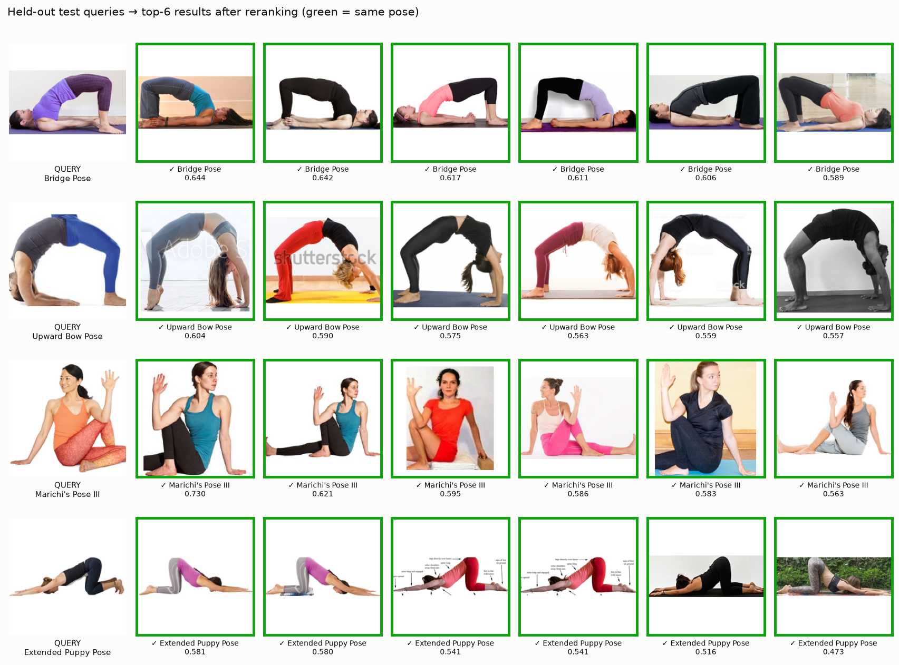
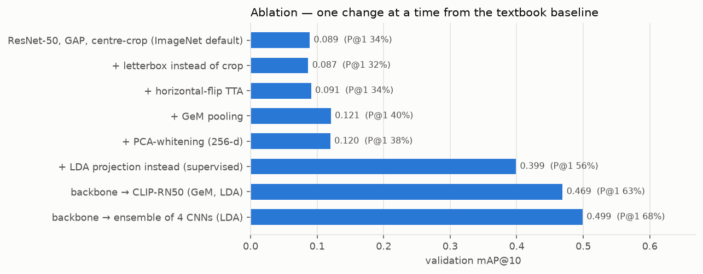
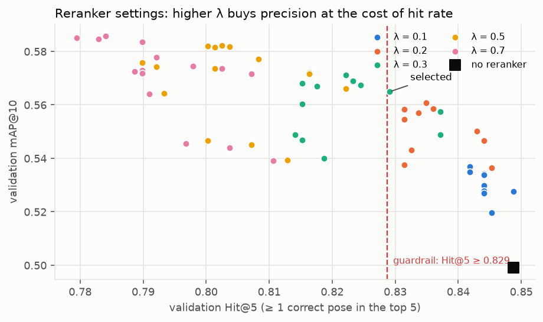
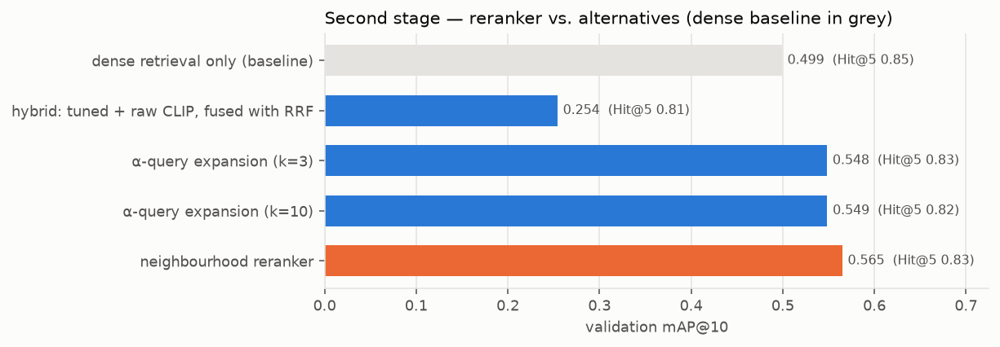
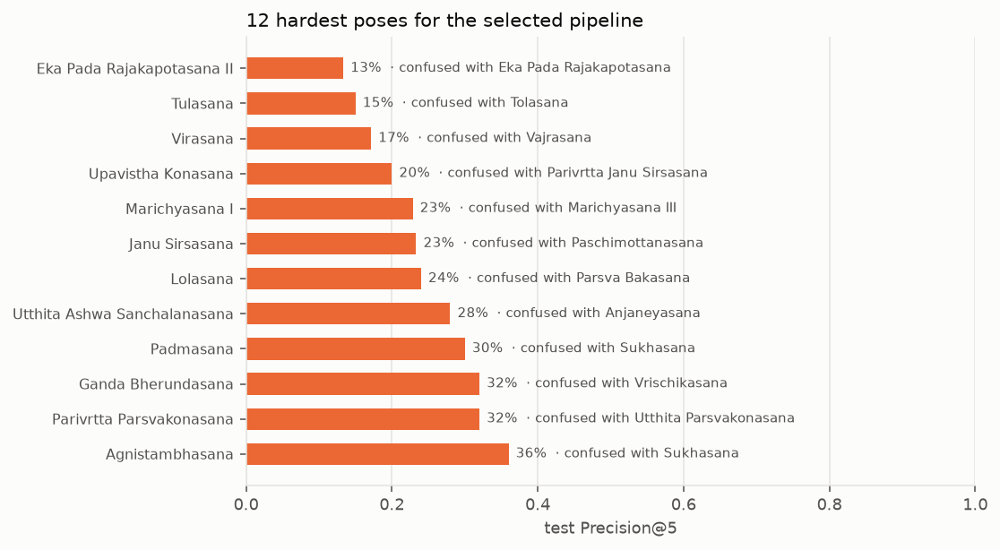
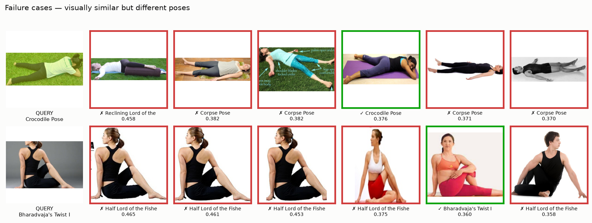
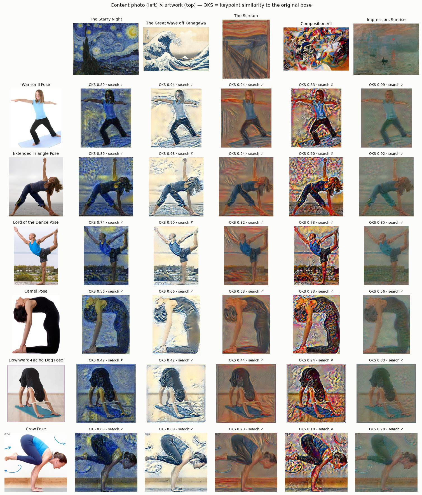
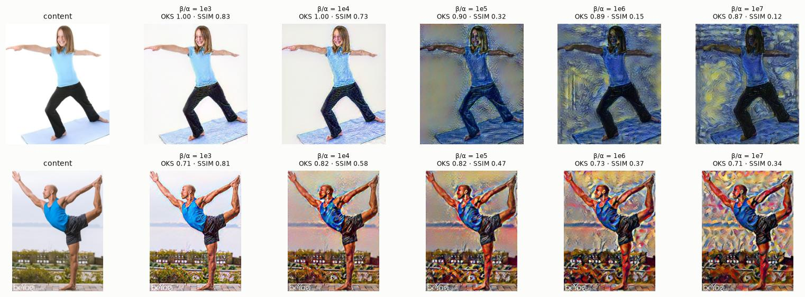
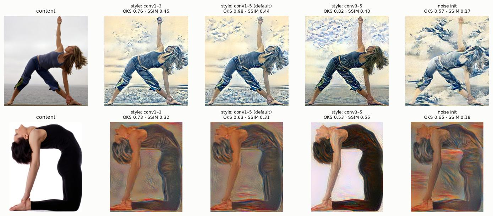

# Multimodal Search & Style Transfer for Yoga Poses

Production-style **image retrieval** over 107 yoga poses. Pre-trained CNN embeddings are stored in
a **Qdrant** vector database and refined by a **reranker**, and a Streamlit app serves image and
text queries. A companion **neural style transfer** study (VGG-19) measures how far a pose photo can
be pushed toward a painting before the pose stops being recognisable.

The repository is a config-driven, stage-by-stage pipeline. Each stage is one commit, explained in
[docs/learning-guide.md](docs/learning-guide.md).

| | Result (held-out test split, through Qdrant) |
|---|---|
| Image → image search | **P@1 0.706 · P@5 0.656 · mAP@10 0.584 · Hit@5 0.849** across 107 poses (chance P@1 ≈ 0.01) |
| Reranker effect | mAP@10 **0.525 → 0.584 (+11%)**, P@5 0.628 → 0.656; costs 2 points of Hit@5 and ~0.02 ms per query |
| Style transfer | 6 poses × 5 artworks. Hokusai and Munch keep the skeleton best (keypoint OKS 0.76 / 0.75); Kandinsky breaks it (0.47). The search engine still recognises the pose in **23 of 30** stylised images, but only 2 of 6 Kandinsky renderings |



---

# Final Architecture

```text
Query photo                                        Query text
    ↓                                                  ↓
Frozen CNN ensemble (ResNet-50, EfficientNetV2-S,  CLIP text encoder
ConvNeXt-T, CLIP RN50) · GeM pooling · flip-TTA        ↓
    ↓                                              Qdrant "pose_texts" collection:
LDA projection fitted on the labelled gallery      CLIP text embeddings of 107 pose descriptions
    ↓                                                  ↓ best-matching pose
                                                   gallery photos of that pose (payload filter)
Qdrant "image" vector (106-d) → top fetch_k
    ↓
Neighbourhood reranker (gallery-neighbour overlap)
    ↓
Top-k results + scores + rank movement (Streamlit)
```

# Key Features

## Tuned embedding pipeline
176 configurations were scored on the validation split: backbone × pooling × preprocessing ×
flip-TTA × post-processing. The winner is a **4-CNN ensemble** with letterbox preprocessing,
horizontal-flip TTA and a **106-d LDA projection** learned on the gallery labels. The CNNs stay
frozen.

## Two-stage retrieval with a reranker
Qdrant returns the top `fetch_k` candidates. A **neighbourhood-overlap reranker** (a light-weight
k-reciprocal re-ranking) rescores them by how much each candidate's own nearest gallery neighbours
overlap with the query's. Its settings are tuned on validation with a **Hit@5 guardrail**.

## Text → image search
Following the reference architecture's text branch, CLIP text embeddings of all 107 pose
descriptions are stored in the vector database. A query like "crow pose" is matched against them,
then answered with that pose's photos. A direct text ↔ image route is also available.

## Explainable UI
Each result shows its final score, its raw cosine similarity and how far the reranker moved it
(`was #7 ↑`). The app also shows per-stage latency (embed → Qdrant → rerank) and the held-out test
metrics.

## Neural style transfer with pose-preservation metrics
Gatys et al. on VGG-19 across 6 poses × 5 public-domain artworks, plus weight, layer and
initialisation ablations. Each result is scored with keypoint **OKS**, **SSIM** and whether the
search engine still recognises the pose.

# Technologies Used

| Component | Technology |
|---|---|
| Embeddings | ResNet-50, EfficientNetV2-S, ConvNeXt-T (torchvision, ImageNet) · CLIP RN50 (open_clip) |
| Projection | shrinkage LDA (scikit-learn), fitted on the gallery |
| Vector store | Qdrant (embedded / local mode): image collection with named vectors + pose-text collection |
| Reranker | neighbourhood overlap (k-reciprocal style); α-query expansion and RRF compared |
| Style transfer | VGG-19 + L-BFGS (PyTorch), Keypoint R-CNN for pose metrics |
| Frontend | Streamlit |
| Evaluation | P@k, mAP@10, Hit@5 · OKS, SSIM |
| Hardware | Apple-silicon GPU (MPS); CUDA / CPU also supported |

# Repository Structure

```text
multimodal-search-yoga-poses/
├── app.py                    # Streamlit UI
├── run_pipeline.py           # runs the stages switched on in config.yaml
├── config.yaml               # every setting: paths, models, search spaces, reranker, style transfer
├── requirements.txt
├── data/                     # generated, git-ignored: images, features, Qdrant index
├── outputs/
│   ├── metrics/              # every result table (CSV / JSON)
│   ├── figures/              # every figure in this README
│   └── screenshots/          # app screenshots
├── notebooks/
│   ├── semantic_search.ipynb # narrated analysis of the search pipeline
│   └── style_transfer.ipynb  # narrated analysis of the style-transfer study
├── docs/learning-guide.md    # the build, one step (= one commit) at a time
├── src/
│   ├── data/                 # download · cleaning · splitting · manifest · pose names
│   ├── embedding/            # backbones · pooling · preprocessing · extractor · postprocess
│   ├── indexing/             # Qdrant vector store · index builder
│   ├── retrieval/            # query encoder · reranker · RRF · search service
│   ├── evaluation/           # metrics · tuning · retrieval eval · text search · figures
│   ├── style_transfer/       # VGG features · losses · optimizer · pose metrics · study · figures
│   └── utils/                # config loader · logger · I/O · device · plotting
├── scripts/capture_screenshots.py
├── assets/styles/            # public-domain artworks (+ sources)
└── tests/                    # pytest, synthetic data only
```

# Installation

```bash
git clone https://github.com/anuradharakh/multimodal-search-yoga-poses.git
cd multimodal-search-yoga-poses
python3.11 -m venv .venv && source .venv/bin/activate     # Python 3.10–3.12
pip install -r requirements.txt
```

The dataset ([Yoga Poses 107](https://www.kaggle.com/datasets/arrowe/yoga-poses-dataset-107), about
1 GB, public) downloads automatically with `kagglehub` on the first run. To use a local copy, set
`source.raw_dir` in `config.yaml`.

# Running the Pipeline

Switch stages on or off in `config.yaml`:

```yaml
pipeline:
  run_data_prep: true       # download → clean → split
  run_embedding: true       # cache CNN features (≈ 7 min on Apple M-series, once)
  run_tuning: true          # 176-configuration grid on val
  run_indexing: true        # Qdrant + projection + reranker neighbour table
  run_retrieval_eval: true  # reranker tuning on val, final test evaluation
  run_style_transfer: false # 48-image study (≈ 17 min)
```

```bash
python run_pipeline.py                          # the enabled stages
python run_pipeline.py --only style_transfer    # one stage
```

# Running the App

```bash
streamlit run app.py        # http://localhost:8501
```

Qdrant's embedded mode locks `data/indexes/qdrant`, so only **one process** can use the index at a
time: one app instance, *or* a notebook, *or* a pipeline run. Stop the other one first. To run
several at once, start a Qdrant server (`docker run -p 6333:6333 qdrant/qdrant`), set
`indexing.qdrant_url: http://localhost:6333` in `config.yaml`, and re-run
`python run_pipeline.py --only indexing`.

| Image upload (a stylised photo, not in the database) | Text search |
|---|---|
|  |  |

# Evaluation

## Retrieval (relevant = same pose)

| Split | Stage | P@1 | P@5 | P@10 | mAP@10 | Hit@5 |
|---|---|---|---|---|---|---|
| val | dense | 0.678 | 0.610 | 0.577 | 0.499 | 0.849 |
| val | dense + reranker | 0.696 | 0.645 | 0.621 | 0.565 | 0.829 |
| **test** | dense | 0.697 | 0.628 | 0.601 | 0.525 | 0.870 |
| **test** | **dense + reranker** | **0.706** | **0.656** | **0.643** | **0.584** | 0.849 |

Run through Qdrant, the validation queries reproduce the offline numbers exactly. The vector search
takes ~21 ms per query and the reranker ~0.02 ms.

<p align="center"></p>
<p align="center"></p>
<p align="center"></p>

**Where it fails.** Errors concentrate in sibling poses that differ in one detail: Lotus vs. Easy,
Hero vs. Thunderbolt, Head-to-Knee vs. Seated Forward Bend. Distinctive silhouettes are
near-perfect.

<p align="center"></p>
<p align="center"></p>

**Text → image: two routes, both through the vector database.**

| Route | Text → image P@10 |
|---|---|
| text embedding vs. CLIP **image** vectors (text ↔ image) | 0.04 |
| text embedding vs. stored **pose-name** embeddings (text ↔ text), then that pose's photos: English name | 0.39 |
| same route, Sanskrit name | **0.75** |

CLIP struggles to match a pose *name* to a photo: zero-shot accuracy over 107 names is ~5%, against
0.9% chance. It is much better at matching text to text. So the text branch of the architecture
stores a CLIP text embedding of each pose's description in a second Qdrant collection. A query is
matched against those descriptions, and the best-matching pose selects photos through a payload
filter. English names score lower than Sanskrit ones because many are near-identical (Warrior
I/II/III, the "… Pose" suffix). One label in the source list, "Scale Pose (another name)", is
written as "Scale Pose" in its description: the parenthetical made that entry match unrelated
queries.

## Style transfer

<p align="center"></p>

Method: Gatys et al. on VGG-19. The generated image starts from the photo and is optimised with
L-BFGS (300 iterations, 384 px, about 17 s per image on MPS). The loss combines `conv4_2` content,
Gram-matrix style at `conv1_1…conv5_1`, and a small total-variation term.

| Artwork | Pose OKS ↑ | SSIM ↑ | Pose recognised by search ↑ | Character |
|---|---|---|---|---|
| Hokusai, *The Great Wave* | **0.76** | **0.45** | 4 / 6 | flat colour, dark outlines; both misses are sibling poses |
| Munch, *The Scream* | 0.75 | 0.39 | **6 / 6** | smooth orange/blue colour field; edges intact |
| Monet, *Impression, Sunrise* | 0.73 | 0.43 | **6 / 6** | subtlest transfer, close to a colour grade |
| Van Gogh, *The Starry Night* | 0.70 | 0.24 | 5 / 6 | strokes everywhere lower SSIM; skeleton mostly survives |
| Kandinsky, *Composition VII* | 0.47 | 0.27 | 2 / 6 | hard-edged confetti, no figure–ground separation; worst on every pose |
| *unstylised photos (reference)* | 1.00 | 1.00 | 4 / 6 | |

Raising the style/content weight β/α from 10³ to 10⁷ drops SSIM from 0.83 to 0.12, while Warrior
II's OKS only falls from 1.00 to 0.87: starting from the photo keeps the pose geometry pinned.
Starting from white noise is twice as slow and loses the most structure (Triangle OKS 0.57 vs. 0.98).
**Takeaway:** artworks with clear figure–ground separation and low-frequency texture preserve yoga
poses. Dense, all-over texture erodes them, worst for compact poses such as Crow.

<p align="center"></p>
<p align="center"></p>

# Architectural Decisions

## Why frozen CNNs plus a learned projection, rather than fine-tuning?
On raw embeddings, every backbone scores mAP@10 ≤ 0.14: they encode clothing and background more
than body configuration. A 106-d **LDA** map fitted on the labelled gallery multiplies mAP by 3–4.5×
in seconds, with no GPU training. Only gallery labels are used, so val and test labels never touch
the fit.

## Why letterbox instead of centre-crop?
Centre-cropping cuts off the hands and feet that define a pose. Once LDA is applied, letterbox wins
for every backbone (ensemble: 0.446 → 0.499).

## Why a reranker, and why this one?
Dense retrieval scores each image independently. The reranker adds context: a true match's own
neighbours overlap with the query's neighbours. There is no image equivalent of a text
cross-encoder; neighbourhood (k-reciprocal) re-ranking is the standard image-retrieval tool. It beat
α-query expansion on val (0.565 vs. 0.549 mAP@10).

## Why a Hit@5 guardrail?
Raising the reranker weight keeps increasing mAP@10, up to ~0.59, but drops Hit@5 from 0.85 to
0.77. The reranker "commits" to the dominant cluster, and when that cluster is the wrong pose the
user sees no correct result at all. Selection therefore maximises mAP@10 subject to Hit@5 falling
≤ 2 points.

## Why not hybrid retrieval with RRF?
In text RAG, BM25 and dense retrieval are both decent and make *different* mistakes. Here the only
second retriever, raw CLIP, is far weaker (mAP 0.12 vs. 0.50), and RRF gives both lists an equal
vote. Fusion drops mAP@10 to 0.254.

## Why Qdrant in local mode?
It provides named vectors and payload filtering (the `split == "gallery"` filter used in evaluation)
and needs no server. The same code targets a Qdrant server or Qdrant Cloud with a one-line change.

# Assumptions & Limitations

* **Relevance means the same pose label.** This is strict: a visually similar sibling pose counts
  as wrong.
* **Exact duplicates are removed; near-duplicates are not.** A few images are the same photo with a
  different crop or caption. A perceptual-hash pass would remove them.
* **Detector-based pose metrics** inherit Keypoint R-CNN's own errors on folded and inverted bodies.

# Future Improvements

- Metric-learning fine-tuning (ArcFace / triplet) of a CNN on the gallery
- Skeleton-keypoint features to separate sibling poses
- Perceptual-hash de-duplication
- A foreground mask so style transfer doesn't paint over the body
- Qdrant server deployment and an evaluation dashboard

# References

* L. Gatys, A. Ecker, M. Bethge. *Image Style Transfer Using Convolutional Neural Networks.* CVPR 2016.
* Z. Zhong, L. Zheng, D. Cao, S. Li. *Re-ranking Person Re-identification with k-reciprocal Encoding.* CVPR 2017.
* F. Radenović, G. Tolias, O. Chum. *Fine-tuning CNN Image Retrieval with No Human Annotation* (GeM, α-QE). TPAMI 2018.
* H. Jégou, O. Chum. *Negative evidences and co-occurrences in image retrieval: the benefit of PCA and whitening.* ECCV 2012.
* G. Cormack, C. Clarke, S. Büttcher. *Reciprocal Rank Fusion outperforms Condorcet and individual rank learning methods.* SIGIR 2009.
* A. Radford et al. *Learning Transferable Visual Models From Natural Language Supervision* (CLIP). ICML 2021.
